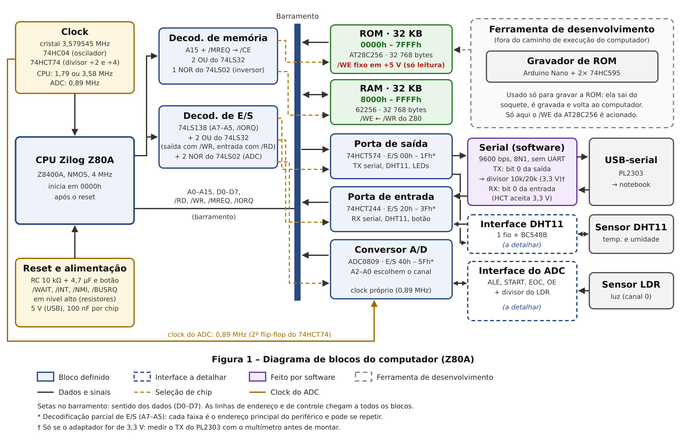

# :computer: Abrigo-80

<!-- Uma frase que diga o que é. Igual à "ideia em uma frase" da proposta. -->
> Computador de 8 bits baseado no Zilog Z80, montado à mão, que registra e interpreta dados do ambiente (luz, temperatura e umidade) com hardware mínimo: um "computador de emergência" para situações de poucos recursos.

<!-- Foto da bancada aqui quando existir. Imagem vale muito na avaliação. -->
<!--  -->
## Diário do projeto

O dia a dia da construção: o que foi feito e estudado, problemas, decisões,
fotos da bancada e próximos passos. Uma entrada por dia, em ordem cronológica.

👉 [Acompanhar o diário](diario/)

- **Status:** em desenvolvimento
- **Etapa atual:** Semana 01 - Eletrônica básica: tensão, corrente, resistor, capacitor, uso do multímetro


--- 
Projeto da disciplina C1AOC (Arquitetura, Organização e Redes de Computadores),
Pós-graduação em Computação Aplicada, IFSP Câmpus Guarulhos, 2026.
Autora: Mariana Freitas de Abreu.

---

## Sumário
1. [Sobre o projeto](#sobre-o-projeto)
2. [Como o computador funciona](#como-o-computador-funciona)
3. [Especificações técnicas](#especificações-técnicas)
4. [Mapas de memória e de E/S](#mapas-de-memória-e-de-es)
5. [Lista de materiais](#lista-de-materiais)
6. [Estrutura do repositório](#estrutura-do-repositório)
7. [Ferramentas](#ferramentas)
8. [Como reproduzir](#como-reproduzir)
9. [Como usar](#como-usar)
10. [Testes](#testes)
11. [Cronograma de estudos](#cronograma-de-estudos)
12. [Cronograma do projeto](#cronograma-do-projeto)
13. [Registro de decisões](#registro-de-decisões)
14. [Problemas conhecidos e riscos](#problemas-conhecidos-e-riscos)
15. [Uso de inteligência artificial](#uso-de-inteligência-artificial)
16. [Referências e créditos](#referências-e-créditos)

---

## Sobre o projeto
<!-- 1 parágrafo: o que a disciplina pede (computador de programa armazenado,
bootloader, SO próprio, programa rodando) e o que esta máquina entrega.
1 parágrafo: por que "computador de emergência" e por que Z80. -->

**Entrega:** 
 14/12/2026 - Protótipo em protoboard, PCB, bootloader em ROM, sistema operacional (monitor), programa-vitrine, artigo e apresentação na Mostra Garagem.

---

## Como o computador funciona
<!-- Esta é a seção mais importante para a defesa oral. Escreva com as suas
palavras, como se explicasse para alguém de software. Se você conseguir
escrever isto sozinha, consegue responder "o que acontece no primeiro ciclo
após o reset?". -->

### Visão geral
<!-- Diagrama de blocos (o mesmo da proposta, atualizado). -->


*Figura 1 – Diagrama de blocos (revisão de 31/10/2026).*[^diagrama]

[^diagrama]: Esta figura revisa a versão enviada na proposta. A arquitetura não mudou (mapa de memória, mapa de E/S, chips e custo continuam os mesmos); as mudanças corrigem erros e deixam o desenho mais preciso:
    1. **ROM só de leitura:** na proposta, o /WR do Z80 ia para as duas memórias.
       Como a AT28C256 é uma EEPROM, uma escrita acidental em 0000h–7FFFh apagaria
       parte do bootloader. Agora o /WE da ROM fica fixo em +5 V e só a RAM recebe o /WR.
    2. **Divisor de tensão da serial:** dois resistores de 10 kΩ geram 2,5 V, e não
       3,3 V como estava indicado. O divisor passou para 10 kΩ/20 kΩ (3,33 V) e foi
       posicionado no caminho do TX (Z80 → adaptador), o único que precisa dele.
    3. **Clock do ADC:** o texto da proposta já citava o clock de 0,89 MHz, mas o
       desenho não mostrava a ligação. Agora há uma linha do bloco Clock até o ADC.
    4. **Portas lógicas:** os decodificadores listam quais portas do 74LS32 e do
       74LS02 cada um usa, mostrando que a conta de portas fecha.
    5. **Setas no barramento:** agora indicam o sentido dos dados (D0–D7) de cada
       bloco, em vez de setas duplas em todos.

<!-- Explique cada bloco em 1 ou 2 linhas: CPU, ROM, RAM, decodificação,
portas de E/S, ADC, clock, reset. Uma analogia com software ajuda. -->

### Do reset ao programa
<!-- A sequência completa, em passos numerados. Exemplo do que cobrir: -->
1. **Reset:** ao ligar, o circuito RC segura /RESET em nível baixo; a CPU zera o
   PC (contador de programa) e começa a buscar a instrução no endereço `0000h`.
2. **Bootloader (ROM):** [estado seguro das portas → teste de RAM 55h/AAh →
   pilha no topo da RAM → mensagem na serial → cópia do SO para 8000h → salto].
3. **Sistema operacional (RAM, 8000h):** mostra o prompt e espera comandos.
4. **Programa-vitrine:** carregado com `CARREGAR` (Intel HEX) e iniciado com `EXEC`.

### Ciclo de busca e execução
<!-- Ligação com o SAP-1: o mesmo fetch-decode-execute, agora com 16 bits de
endereço, pilha e chamadas. Use a tabela "Ponte" do enunciado como base. -->

### Comunicação serial por software
<!-- Explique bit-banging: sem chip de UART, o próprio programa liga e desliga o
bit 0 da porta de saída no tempo certo (9600 bps = ~104 µs por bit). Diga de
onde veio o cálculo de tempo (ciclos de clock por instrução). -->

---

## Especificações técnicas

| Item | Especificação |
|---|---|
| CPU | Zilog Z80A (Z8400A, NMOS, até 4 MHz) |
| Clock | Cristal 3,579545 MHz + 74HC04 (oscilador) + 74HCT74 (divisor); CPU a 1,79 MHz ou 3,58 MHz por jumper |
| ROM | AT28C256 (EEPROM 32 KB) |
| RAM | 62256 (SRAM 32 KB) |
| Decodificação de memória | A15 + /MREQ, com 74LS32 e 74LS02 |
| Decodificação de E/S | 74LS138 (A7–A5, habilitado por /IORQ) |
| Porta de saída | 74HCT574 (latch de 8 bits) |
| Porta de entrada | 74HCT244 (buffer three-state) |
| Conversor A/D | ADC0809 (8 bits, 8 canais), clock de 0,89 MHz |
| Sensores | LDR (luz, via ADC) e DHT11 (temperatura e umidade) |
| Comunicação | Serial por software, 9600 bps 8N1, adaptador USB-serial PL2303 |
| Alimentação | 5 V via USB (módulo MB102), 100 nF por chip |
| Reset | RC 10 kΩ + 4,7 µF com botão |
| Software | Bootloader e SO em Assembly Z80 (código próprio) |

---

## Mapas de memória e de E/S

### Memória
| Faixa | Dispositivo | Conteúdo |
|---|---|---|
| `0000h–7FFFh` | ROM | bootloader + imagem do SO |
| `8000h–[xxxx]h` | RAM | SO (copiado no boot) |
| `[xxxx]h–[xxxx]h` | RAM | programa do usuário |
| `[xxxx]h–FFFFh` | RAM | pilha (cresce para baixo) |

<!-- Defina as faixas de dentro da RAM quando o SO tiver tamanho conhecido. -->

### E/S
| Faixa | Dispositivo | Bits usados |
|---|---|---|
| `00h–1Fh` | Saída (74HCT574) | bit 0 = TX; bit [x] = DHT11; bits [x–x] = LEDs |
| `20h–3Fh` | Entrada (74HCT244) | bit 0 = RX; bit [x] = DHT11; bit [x] = botão |
| `40h–5Fh` | ADC0809 | A2–A0 escolhem o canal; canal 0 = LDR |

> Decodificação parcial: cada periférico responde em toda a faixa; os programas
> usam só o primeiro endereço de cada uma.

---

## Lista de materiais

**Situação:**
`em mãos` já está na bancada ·
`aguardando` comprado, esperando retirada ou entrega ·
`em falta` a loja não tinha; comprar em outro lugar ·
`a confirmar` não sei se veio no pedido ·
`a comprar` necessário e ainda não comprado

### Núcleo do computador
| Qtd | Item | Para que serve | Onde | Situação |
|---|---|---|---|---|
| 1 | Z80A (Z8400A, NMOS, 4 MHz, DIP-40) | CPU | Multicomercial | em mãos |
| 1 | AT28C256-20PI (EEPROM 32 KB, DIP-28) | ROM: bootloader e SO | Mercado Livre | em mãos |
| 1 | 62256-70 (SRAM 32 KB, DIP-28) | RAM | Mercado Livre | em mãos |

### Lógica e decodificação
| Qtd | Item | Para que serve | Onde | Situação |
|---|---|---|---|---|
| 1 | 74LS32 [conferir: LS ou HCT] (4 portas OU) | /CE das memórias e pulsos das portas | Multicomercial | em mãos |
| 1 | 74LS02 [conferir: LS ou HCT] (4 portas NOR) | inversor do A15 e sinais do ADC | Multicomercial | em mãos |
| 1 | 74LS138 [conferir: LS ou HCT] (decodificador 3→8) | decodificação de E/S | Multicomercial | em mãos |
| 1 | 74HCT574 (latch de 8 bits) | porta de saída | Multicomercial | em mãos |
| 1 | 74HCT244 (buffer three-state) | porta de entrada | - | a comprar |

### Clock, reset e alimentação
| Qtd | Item | Para que serve | Onde | Situação |
|---|---|---|---|---|
| 1 | Cristal 3,579545 MHz (HC-49/S) | base do clock | Multicomercial | em mãos |
| 1 | 74HC04 (6 inversores) | oscilador do cristal | Multicomercial | em mãos |
| 1 | 74HCT74 (2 flip-flops) | divisor ÷2 (CPU) e ÷4 (ADC) | Multicomercial | em mãos |
| 1 | Resistor 1 MΩ | realimentação do oscilador | kit de resistores | em mãos |
| 2 | Capacitor cerâmico 22 pF | carga do cristal | kit de capacitores | em mãos |
| 1 | Capacitor eletrolítico 4,7 µF | circuito de reset (RC) | kit de capacitores | em mãos |
| 1 | Chave táctil | botão de reset | Multicomercial / Mercado Livre | em mãos |
| 2 | Módulo fonte MB102 | 5 V nas protoboards | Mercado Livre | em mãos |
| 1 | Cabo USB macho-macho | alimentar o MB102 pelo notebook | Mercado Livre | em mãos |
| ~12 | Capacitor cerâmico 100 nF | desacoplamento, um por chip | kit de capacitores | em mãos |

### Entrada, saída e sensores
| Qtd | Item | Para que serve | Onde | Situação |
|---|---|---|---|---|
| 2 | ADC0809CCN (DIP-28) | conversor A/D (1 reserva) | Multicomercial | em mãos |
| 1 | Módulo DHT11 (GC-289) | temperatura e umidade | Santa Ifigênia | aguardando |
| 1 | Transistor BC548B | interface de 1 fio do DHT11 | kit / Santa Ifigênia | em mãos |
| 1 | LDR LG5516 | sensor de luz | Multicomercial | em mãos |
| 1 | Adaptador USB-serial PL2303 | terminal no notebook | Mercado Livre | em mãos |
| 3 | Resistor 10 kΩ | divisor do TX (2 em série = 20 kΩ) | kit de resistores | em mãos |
| 4+ | LED + resistor 330 Ω | LEDs de estado | kit | em mãos |
| 1 | Chave táctil | botão de uso geral | Multicomercial / Mercado Livre | em mãos |
| 4 | Resistor 10 kΩ | pull-up de /WAIT, /INT, /NMI, /BUSRQ | kit de resistores | em mãos |

### Gravador de ROM (ferramenta de desenvolvimento)
| Qtd | Item | Para que serve | Onde | Situação |
|---|---|---|---|---|
| 1 | Arduino Nano V3.0 (CH340) + cabo | controla a gravação | Multicomercial | em mãos |
| 2 | 74HC595 (registrador de deslocamento) | gera os 15 bits de endereço | Multicomercial | em mãos |
| 1 | Soquete ZIF 28 pinos (ou soquete DIP comum) | tirar e pôr a ROM sem entortar os pinos | — | a comprar |

### Montagem
| Qtd | Item | Para que serve | Onde | Situação |
|---|---|---|---|---|
| 4 | Protoboard | montagem do protótipo | Multicomercial | em mãos |
| 1 | 2 metros de cabo de rede | ligações curtas na protoboard | Mell Eletrônicos | em mãos |
| 1 | Kit de jumpers macho-macho | ligações longas | Multicomercial | em mãos |
| 1 | Kit de resistores | diversos | Multicomercial | em mãos |
| 1 | Kit de capacitores | diversos | Multicomercial | em mãos |

### Ferramentas
| Qtd | Item | Para que serve | Onde | Situação |
|---|---|---|---|---|
| 1 | Multímetro DT-830B (+ bateria 9 V) | medir tensões e continuidade | Multicomercial | em mãos |
| 1 | Ferro de solda 127 V | montagem da PCB | Mercado Livre | em mãos |
| 1 | Estanho | solda | Multicomercial | em mãos |
| 1 | Óculos de proteção | segurança na solda | próprio | em mãos |
| 1 | Alicate de corte | cortar terminais e fios | próprio | em mãos |

### Placa de circuito impresso
| Qtd | Item | Para que serve | Onde | Situação |
|---|---|---|---|---|
| 1 | PCB dupla face (KiCad) | versão final da máquina | fabricante [a definir] | a comprar (após o esquemático) |
| ~10 | Soquetes DIP (14, 20, 28 e 40 pinos) | chips removíveis na PCB | [a definir] | a comprar (com a PCB) |

---

## Estrutura do repositório

```
abrigo-80/
├── README.md               # visão geral, especificações, como reproduzir
├── diario/                 # diário do projeto (uma entrada por dia)
│   ├── _modelo.md          # template para copiar a cada dia
│   ├── AAAA-MM-DD.md       # entradas datadas
│   └── fotos/              # fotos do dia a dia da bancada
├── hardware/
│   ├── kicad/              # esquemático e layout da PCB
│   └── gravador-rom/       # esquema do gravador com Arduino Nano
├── firmware/
│   ├── bootloader/         # Assembly Z80
│   ├── so/                 # monitor (sistema operacional)
│   └── vitrine/            # programa registrador de dados
├── gravador/               # sketch do Arduino que grava a AT28C256
├── docs/
│   ├── diagramas/
│   │   ├── figura1.png     # diagrama de blocos (imagem usada no README)
│   │   └── figura1.svg     # fonte editável do diagrama
│   ├── fotos/              # fotos oficiais da máquina (usadas no README e no artigo)
│   └── datasheets.md       # links para os datasheets usados
└── testes/                 # registros de testes (medições, saídas da serial)
```

---

## Ferramentas
<!-- Nome e versão de cada ferramenta: sem isso, ninguém reproduz. -->
| Ferramenta | Uso |
|---|---|
| [assembler Z80, ex.: sjasmplus ou z80asm] | montar o Assembly em binário |
| [emulador Z80] | testar bootloader e SO antes de gravar |
| Arduino IDE | sketch do gravador de ROM |
| KiCad [versão] | esquemático e PCB |
| [minicom / picocom / screen] | terminal serial no Linux |
| Multímetro DT-830B | medir tensões |

---

## Como reproduzir
<!-- Passo a passo na mesma ordem dos testes. Cada etapa: o que montar,
como verificar, o que esperar. -->

### 1. Montar o hardware
1. Fonte: ligar o MB102, medir 4,75–5,25 V **antes** de colocar os chips.
2. Clock e reset.
3. CPU em modo NOP (barramento de dados em zero) para ver os endereços contando.
4. ROM e RAM com decodificação.
5. Portas de E/S, serial, ADC e DHT11.

### 2. Montar o código
```bash
# exemplo; troque pelo assembler escolhido
[comando para montar bootloader + SO em rom.bin]
```

### 3. Gravar a ROM
<!-- Como ligar a AT28C256 no gravador, como enviar o rom.bin, como verificar
a gravação (ler de volta e comparar). -->

### 4. Ligar e conectar o terminal
```bash
[comando do terminal, ex.: picocom -b 9600 /dev/ttyUSB0]
```

---

## Como usar

### Comandos do sistema operacional
| Comando | O que faz |
|---|---|
| `AJUDA` | lista os comandos |
| `LER` | mostra luz, temperatura e umidade |
| `CARREGAR` | recebe um programa em Intel HEX pela serial e grava na RAM |
| `EXEC` | executa o programa carregado |

### Chamadas de sistema (`RST 08h`, função em `C`)
| C | Função | Entrada | Saída |
|---|---|---|---|
| [00h] | escrever caractere | A = caractere | — |
| [01h] | ler caractere | — | A = caractere |
| [02h] | escrever texto | HL = endereço (terminado em [00h]) | — |
| [03h] | ler ADC | A = canal | A = valor |
| [04h] | ler DHT11 | — | [registradores] |

### Programa-vitrine
<!-- Menu (medir / listar últimas 16 / estatísticas), exemplo de tela,
como carregar. Um print do terminal aqui ajuda muito. -->

---

## Testes
<!-- Atualize o status a cada etapa e guarde a evidência em testes/. -->

| # | Etapa | Critério de sucesso | Status |
|---|---|---|---|
| 1 | Fonte | 4,75–5,25 V no multímetro | Feito, evidências e relato no dia 31/10 |
| 2 | Clock | frequência medida com o Arduino Nano | pendente |
| 3 | CPU (NOP) | linhas de endereço contando | pendente |
| 4 | ROM e RAM | LED acende e teste de RAM passa | pendente |
| 5 | Serial | mensagem de boas-vindas e eco de teclas | pendente |
| 6 | Sensores | leituras mudam com o ambiente | pendente |
| — | Emulador | bootloader e SO rodam antes da gravação | pendente |

---

## Cronograma de estudos
<!-- O que precisa saber ANTES de cada etapa de montagem. O plano dia a dia
está no cronograma de estudos completo; aqui fica o resumo por semana. -->

| Semana | Período | Tema | Para quê | Andamento |
|---|---|---|---|---|
| 1 | 30/10–05/11 | Eletricidade básica (tensão, corrente, resistência, Lei de Ohm, capacitor, multímetro), Arduino Nano e primeiros passos em Assembly Z80 | medir a fonte com segurança; preparar o gravador e o código | Em andamento: 30/10, 31/10, 02/11 e 03/11 concluídos; 04/11 adiantado para 03/11 |
| 2 | 06/11–13/11 | Lógica digital (portas, níveis LS/HC/HCT, flip-flop, three-state, 74LS138), pinos do Z80, pilha e CALL/RET, início do KiCad | entender os chips e ligar a CPU | A fazer |
| 3 | 14/11–22/11 | Gravador de ROM, clock a cristal, Z80 em teste NOP, ROM, RAM e decodificação de memória | CPU executando da ROM | A fazer |
| 4 | 23/11–29/11 | Decodificação de E/S, portas 74HCT574 e 74HCT244, serial por software 9600 8N1, bootloader | mensagem na serial ao ligar | A fazer |
| 5 | 30/11–06/12 | Sistema operacional (monitor, Intel HEX, RST 08h), ADC0809 com LDR, DHT11 | prompt com comandos e sensores | A fazer |
| 6 | 07/12–10/12 | Programa-vitrine (buffer de 16 leituras, média, máximo e mínimo), testes, checkpoint | vitrine rodando; checkpoint em 10/12 | A fazer |
| 7 | 11/12–17/12 | PCB (se chegou), vídeo de reserva, ensaio da defesa, artigo | Mostra em 14/12; artigo até 17/12, 18h | A fazer |
| PCB | 06/11–21/11 | Esquemático e layout no KiCad, em paralelo | encomenda da PCB por volta de 20/11 | A fazer |

---

## Cronograma do projeto

| Período | Marco | Entregável | Status |
|---|---|---|---|
| até 29/10 | Proposta | PDF no AVA | concluído |
| 30/10–02/11 | Compra e retirada dos componentes | peças em mãos | [ ] |
| 30/10–13/11 | Esquemático no KiCad (início) | esquemático preliminar | [ ] |
| ~20/11 | Encomenda da PCB | pedido feito | [ ] |
| 14/11–22/11 | Gravador de ROM; fonte, clock, reset, CPU, ROM, RAM | CPU executando da ROM | [ ] |
| 23/11–29/11 | Decodificação, portas de E/S, bootloader | LED + mensagem na serial | [ ] |
| 30/11–06/12 | Sistema operacional e sensores | prompt com comandos | [ ] |
| 07/12–09/12 | Programa-vitrine e testes | vitrine rodando | [ ] |
| **10/12** | **Checkpoint** | protoboard com CPU, ROM, RAM, bootloader e serial | [ ] |
| 11/12–13/12 | PCB (se chegou), vídeo de reserva, ensaio | vídeo + roteiro | [ ] |
| **14/12** | **Mostra Garagem** (19h30–22h) | demonstração ao vivo | [ ] |
| **17/12, 18h** | **Artigo e documentação** | PDF no AVA + repositório | [ ] |

---

## Registro de decisões
<!-- Uma linha por decisão, no dia em que decidir. Formato curto:
data | decisão | alternativas | motivo. Isto vira a seção de projeto do artigo. -->

| Decisão | Alternativas consideradas | Motivo |
|---|---|---|
| Z80 como plataforma | 8088, FPGA | reset em 0000h, barramento sem multiplexação, menos chips de apoio |
| Serial por software | UART 6850 | 6850 difícil de encontrar no Brasil |
| Gravador próprio com Arduino | TL866II Plus | custo e prazo de importação |
| Z80A NMOS | Z84C00 CMOS | disponível e barato; suficiente para o projeto |
| ... | | | |

---

## Problemas conhecidos e riscos
<!-- O que falhou, como foi resolvido, o que ainda não funciona.
Inclua os riscos da proposta e o plano B de cada um. -->

| Problema | Solução | 
|--- | --- |
| Falta de conhecimento na área de elétrica, eletrônica e hardware | Foi montado um cronograma de estudos, com apoio da inteligẽncia artificial, que avance junto com a construção do projeto, utilizando principalmente aulas da UNIVESP e livros didáticos| 
| Dificuldade em encontrar um kit de jumper U | Foi comprado 2 metros de cabo de rede e utilizado os fios rigidos internos| 
| A protoboard é dividida ao meio, nas conexões positivas e negativas | Adicionar um fio rigido interligando as fileiras | 
---

## Uso de inteligência artificial
<!-- Declare onde usou IA (orientação, revisão de texto, apoio em código) e afirme que entende e sabe explicar tudo o que foi incluído, como pede o enunciado. -->
O trabalho foi totalmente apoiado por inteligência artificial, utilizando o Claude, Opus 5.5, nível médio. A Inteligência Artificial funcionou como recurso de ideias, acompanhamento de estudos, criação de cronograma de estudos e andamento do projeto, revisão de texto, orientação e apoio em código.

---

## Referências e créditos
- MALVINO, A. P.; BROWN, J. A. *Digital Computer Electronics*. 3. ed. McGraw-Hill, 1993. Cap. 10.
- ARAUJO, Blau. *Projetando e Montando um Computador 8-Bits #1 – Arquitetura SAP-1*. YouTube, canal debxp, 2020.
- Zilog. *Z80 CPU User Manual*.
- Grant Searle, projetos Z80 (referência de projeto).
- RC2014 (referência de projeto).
- Datasheets: [listar cada um com link em docs/datasheets.md]
- [Bibliotecas ou códigos de terceiros usados, se houver. Bootloader e SO são próprios.]

### Fontes de aulas e materiais de estudo
- [Circuitos Elétricos - Curso de Engenharia da Computação | UNIVESP](https://www.youtube.com/playlist?list=PLxI8Can9yAHd1UnLqOLBQv7KbDq4Zsbax)
- BRAGA, Newton C. **Curso de eletrônica**: eletrônica básica. São Paulo: Instituto Newton C. Braga, 2012. v. 1.
- [Fisica III | UNIVESP](https://www.youtube.com/playlist?list=PLxI8Can9yAHdj5jB2sFXlr0l6OHBxtxeJ)
- FUNDAMENTOS da eletricidade. São Paulo: SENAI-SP Editora, 2015. E-book. ISBN 978-85-8393-229-1.
- BAUER, Wolfgang; WESTFALL, Gary D.; DIAS, Helio. **Física para universitários**: eletricidade e magnetismo. Porto Alegre: AMGH, 2012. 386 p. ISBN 978-85-8055-125-9.
- JEWETT JR., John W.; SERWAY, Raymond A. **Física para cientistas e engenheiros**: eletricidade e magnetismo. 2. ed. São Paulo: Cengage Learning, 2017. v. 3. 416 p. ISBN 978-85-221-2710-8.


## Licença
[ex.: MIT para o código, CC BY 4.0 para documentação e esquemáticos]