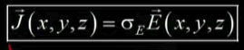
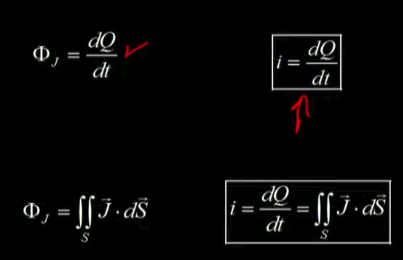
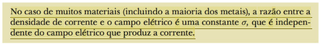
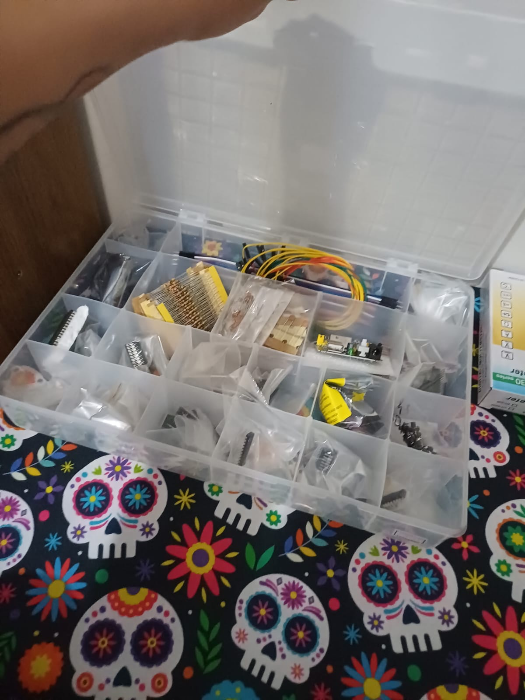
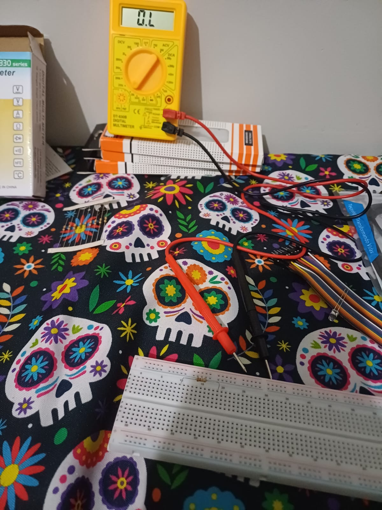
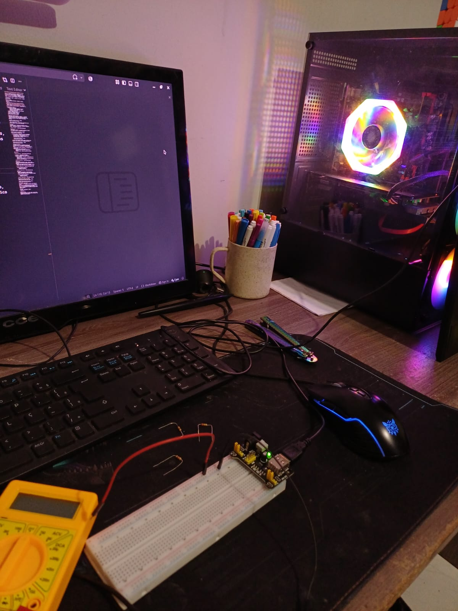

# 31-10-2026: Lei de Ohm, GND e curto-circuito, protoboard por dentro  · Título curto do dia

**Resumo:** Estudei sobre a lei de Ohm, o que é um GND e curto-cirtuito e vi como é uma protoboard por dentro, também montei o MB102
**Tempo dedicado:** 2h30 5 pomos de 30x7x20
**Etapa do cronograma:** ex.: montagem do clock e do reset

---

## O que fiz
- Testei alguns componentes com o multímetro
- Montei um circuito utilizando led e interruptor

## O que estudei
<!-- Sempre com a fonte: vídeo, capítulo, página do datasheet, link.
     Essas fontes viram as referências do artigo. -->
**Tema:** Lei de Ohm
**Fontes:**
- [Aula 04 do curso de fisica III da UNIVESP](https://www.youtube.com/watch?v=EQN-YuuDeHM)
- FUNDAMENTOS da eletricidade. São Paulo: SENAI-SP Editora, 2015. E-book. ISBN 978-85-8393-229-1.
- BAUER, Wolfgang; WESTFALL, Gary D.; DIAS, Helio. **Física para universitários**: eletricidade e magnetismo. Porto Alegre: AMGH, 2012. 386 p. ISBN 978-85-8055-125-9.
- JEWETT JR., John W.; SERWAY, Raymond A. **Física para cientistas e engenheiros**: eletricidade e magnetismo. 2. ed. São Paulo: Cengage Learning, 2017. v. 3. 416 p. ISBN 978-85-221-2710-8.

### Lei de Ohm microscópica

- A condutividade elétrica é a capacidade de um material de conduzir eletrons
- Depende da condutividade elétrica, caraterística constante do material, cada material tem uma condutividade elétrica diferente
- A condutividade elétrica é representado pelos Siemens (S/m)
- A resistividade é o contrário da condutividade
- Quanto maior a condutifidade de um material, melhor condutor é esse material
- O fluxo do vetor de quantidade de correntes, é o produto entre a densidade de corrente e a área disponível
- Corrente elétrica é o fluxo da densidade do fluxo atráves da superfície e tem o sentido contrário ao movimento dos elétrons, o I indica o sentido da densidade da corrente

Lei de Ohm

**Tema:** Protoboard
**Fontes:**
- [Como funciona uma protoboard? - Manual do Mundo](https://www.youtube.com/watch?v=DfU6llvIMcM)

Estudei sobre como funciona e é montada uma protoboard por dentro, também realizei medições dos componentes e montei um sistema para ligar um led

## Problemas e como resolvi
**Problema:** Dificuldade em encontrar kit de jumpers U prontos
**O que tentei:** Conversei com a IA e com os vendedores da loja sobre alternativas para os fios rigidos
**Solução:** Invés de utilizar Jumpers U de kits prontos, comprei cabo de internet e o desmontei ṕra pegar os fios rigidos de dentro

## Decisões
| Decisão | Alternativas | Motivo |
|---|---|---|
| Invés de usar jumpers U prontos, utilizarei o fio rígido existente dentro do cabo de internet | Eu poderia compar o kit pronto online | A decisão foi tomada para agilizar o trabalho e diminuir custos |

## Medições
| O quê | Esperado | Medido | OK? |
|---|---|---|---|
| Resistor 10 kΩ (Ω, escala 20k) | 9,50 a 10,50 kΩ | 10,05 kΩ | ✅ |
| Resistor 220 kΩ (Ω, escala 2000k) | 209 a 231 kΩ | 1222 kΩ | ✅ |
| Resistor 47 kΩ (Ω, escala 200k) | 44,6 a 49,4 kΩ | 147,0 kΩ | ✅ |
| Resistor 10 MΩ (Ω, escala 2000k) | acima de 2 MΩ | “1” (fora da escala) | ✅ |
| MB102 | 4,75 e 5,25 V nos dois lados | 3,15 kΩ | ✅ |

## Dúvidas
- Ainda estou com dificuldade pra aplicar a lei de Ohm

## Fotos & videos

[Video - Primeiro circuuito montado, LED + interruptor](../fotos/video_primeiro_circuito_led.mp4)

## Próximo passo
- Dia 02-11 irei estudar sobre resistores (código de cores), capacitor e polaridade do eletrolítico, multímetro e criar um bipe de continuidade nos fios da protoboard
[ Anotações do 02-11 ](11-02.md)