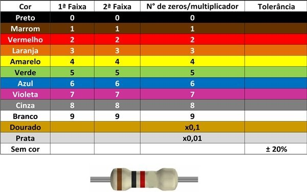

# 02-11-2026 · Bipe de continuidade e aprendendo mais sobre resistores

**Resumo:** O dia de hoje foi focado em aprender mais sobre resistores e montar um bipe de continuidade
**Tempo dedicado:** 3h
**Etapa do cronograma:** Semana 01 - Eletricidade básica e primeiros passos em Assembly

---

## O que estudei
<!-- Sempre com a fonte: vídeo, capítulo, página do datasheet, link.
     Essas fontes viram as referências do artigo. -->
### Tema: código de cores do resistor

**Desafio, antes de olhar o kit: quais seriam as cores de 10 kΩ, 4,7 kΩ e 1 MΩ?**
**Resposta:**
- 10 kΩ = Marrom, preto e laranja
- 4,7 kΩ = Amarelo, violeta e vermelho
- 1 MΩ = Marrom, preto e verde

### Tema: Medir resistência

Gire o seletor para a faixa Ω e encoste as pontas nas duas pernas do resistor solto.

**Pergunta para pensar: por que o resistor precisa estar fora do circuito (ou com a fonte desligada) para medir resistência?** Pista: o multímetro mede resistência injetando uma pequena corrente própria.

**Resposta:** a fonte precisa estar desligada porque o multímetro mede resistência mandando uma pequena corrente própria pelo resistor; a tensão da fonte se misturaria com a dele e a leitura sairia errada, podendo até danificar o multímetro. E o resistor precisa estar fora do circuito porque, se ele estiver ligado a outras peças, a corrente do multímetro pode passar também por elas (um caminho em paralelo), e a leitura sai menor que o valor real do resistor.

### Tema: Capacitores

Um capacitor é uma pequena caixa-d’água: armazena carga e solta quando a tensão cai. No seu projeto ele tem dois papéis:

Cerâmico de 100 nF: um ao lado de cada chip, para cobrir as “quedas” rápidas de tensão. Ele vem marcado com um código de três números: os dois primeiros são dígitos e o terceiro é a quantidade de zeros, em picofarads.

**Desafio:** qual código aparece num capacitor de 100 nF? (100 nF = 100.000 pF.)
**Resposta:** O código seria 104

Eletrolítico de 4,7 µF: usado no reset. Ele tem polaridade: perna longa no +, e a faixa pintada na lateral marca o −. Ligado invertido, ele pode estufar ou estourar.

**Prática**
1. Medir os resistores do desafio e conferir se o valor fica dentro dos 5% de tolerância.
2. Teste de continuidade: coloque o seletor no símbolo de diodo/som e encoste as pontas uma na outra. Atenção: muitos DT-830B não têm bipe. Se o seu não apitar, use a faixa 200 Ω: perto de 0 significa ligado, e “1” no canto esquerdo significa aberto. Depois teste as fileiras da protoboard: dois furos da mesma fileira, depois furos de fileiras diferentes, depois uma ponta em cada lado do vão central, e as trilhas laterais de uma ponta à outra.

## Próximo passo
<!-- A primeira coisa a fazer na próxima sessão.
     Concreto o bastante para começar sem precisar pensar. -->
- Amanhã irei estudar sobre Arduino Nano e a porta serial no Linux, também irei instalar a Arduino IDE; se a porta não abrir, entrar no grupo uucp; "Blink" e LED externo

[ Anotações do 03-11 ](11-03.md)