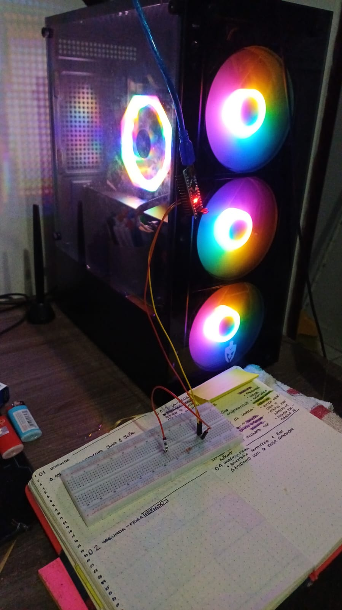

# 03-11-2026 · Blink no Nano + Introdução à Assembly

**Resumo:** Arduino Nano e a porta serial no Linux
**Tempo dedicado:** 2h
**Etapa do cronograma:** Arduino Nano e a porta serial no Linux

---

## O que fiz
- Montei um sistema para rodar o programa Blink no Arduino Nano

## O que estudei
### Tema: Programação em arduino
**Fontes:**
- [Documentação do Arduino Nano](https://docs.arduino.cc/hardware/nano/)

### Tema: Programação Assembly
**Fontes:**
- [Cheatsheet dos comandos Assembly](https://marmsx.msxall.com/cursos/assembly/z80_instr.html)
- [Curso de Assembly](https://marmsx.msxall.com/cursos/assembly/assembly4.html

- Aprendi como o codigo guarda a informação e seus comandos
- Recaptulei como funciona os bytes para hexadecimal
- Montei e compilei um primeiro programa de soma e subtração com Assembly

## Problemas e como resolvi
<!-- Escreva os três: o que aconteceu, o que tentou, o que funcionou.
     Se não resolveu ainda, deixe registrado mesmo assim.
     Esta seção alimenta as "lições aprendidas" do artigo. -->
**Problema:** erro de permissão ao enviar o programa para o Nano.
**O que tentei:** rodei `sudo usermod -aG uucp $USER`, mas o erro continuou.
**O que funcionou:** no Arch, a porta /dev/ttyUSB0 pertence ao grupo uucp (conferido com `stat -c %G /dev/ttyUSB0`). O usermod adiciona o usuário ao grupo, mas a sessão só lê os grupos no login. Depois de sair e entrar de novo, o `id` mostrou o uucp e o envio funcionou.

**Problema:** Arduino não encaixando direito na protoboard
**O que tentei:** Tentei pressionar mais mas não encaixou
**O que funcionou:** Adicionei dois jumpers macho-femea, assim encaixando com mais segurança

## Fotos

[Video do meu primeito sistema em arduino](../fotos/video-primeito_programa_arduino.mp4)

---

## Próximo passo
<!-- A primeira coisa a fazer na próxima sessão.
     Concreto o bastante para começar sem precisar pensar. -->
-