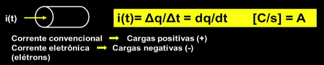
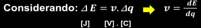
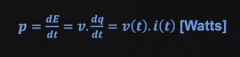
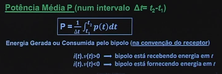
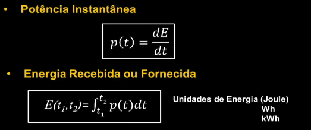
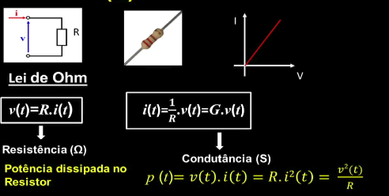
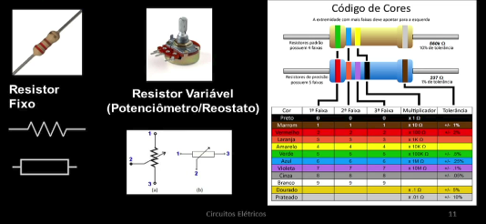
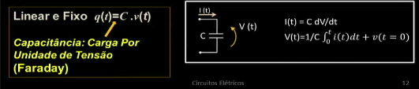
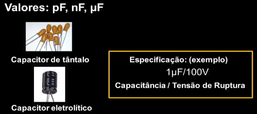

# 30-10-2026 · Aprendendo/Revisando grandezas elétricas

**Resumo:** Primeiro aprendizado, grandezas elétricas, estudando sobre tensão, corrente, resistência
**Tempo dedicado:** Cerca de 1h30, 3 pomodoros de 30x15x20
**Etapa do cronograma:** Semana 01 - Eletrônica básica: tensão, corrente, resistor, capacitor, uso do multímetro

---
## O que estudei
**Tema:** Grandezas elétricas | Corrente, resistor, capacitor...
**Fontes:**
- [Aula 01 & 02 do curso de circuitos elétricos da UNIVESP](https://www.youtube.com/watch?v=9T11Fph2pB8&list=PLxI8Can9yAHd1UnLqOLBQv7KbDq4Zsbax)
- BRAGA, Newton C. **Curso de eletrônica**: eletrônica básica. São Paulo: Instituto Newton C. Braga, 2012. v. 1.

## Pensamentos e notas
- Aproximações consideradas
     - Resposta instantânea, pequenos circuitos
     - Carga total em cada componente é nula
     - Elementos lineares fixos
     - Conservação da energia → Leis de Kirchoff
- Tensão é medida em Volts (V)
- Corrente é medida por Ampères (A)
- Resistência é medida em Ohm (Ω)

### Carga e corrente elétrica
- Uma carga pode ser positiva ou negativa, é a grandeza fundamental do eletromagnetismo, medido em Coulomb [q]
- Corrente elétrica (i) é o fluxo de cargas através de um condutor, existem a corrente continua e a corrente alternada

- Uma corrente positiva é uma corrente convencional e uma corrente negativa é uma corrente eletrônica

### Tensão
- Tensão elétrica é a diferença de potencial entre o ponto A e ponto B, é a variação de energia por unidade de carga, é definida por Volts (V)

### Potência
- Uma potencia elétrica é a variação de energia no bipolo por unidade de tempo, é definida por Watts

- A potência pode ser definida por média ou instantanea
     - A instatânea é a potencia que é dissipada num derteminado bipolo  em um instante t
     - A potência média é a média da potencia em um determinado periodo de tempo

     

- A relação de potencia e energia pode ser definida pelas unidades Joules, Wh(Watt/hora) ou KWh(kilowatt/hora)

 

 ### Bipolos eletricos
- Um bipolo elétrico é um componente onde passa uma corrente elétrica, se vai de A → B tem uma tensão positiva (v > 0), se vai de B → A é uma tenção negatia (v < 0)
- Existem alguns bipolos elementares, um exemplo dele é o bipolo linear
- Dentro dos bipolos lineares existem:
     - Bipolos passivos: Resistores, Capacitores e indutores
     - Bipolos ativos: Fontes de tensão e de corrente

#### Resistor

- O resistor é um dissipador de energia
- O resistor é definido como resistencia (Ω)
- Tipos de resistores
     - Fixo: O valor da resistencia é determinado por um código de cores
     - Variável ou Potênciometro: A resistencia varia de acordo com a posiçãod e ajuste

#### Capacitor
- Elemento de armazenador de carga, conjunto d duas placas paralelas com cargas negativas em uma e positivas em outras
- Sempre as quantidades de cargas serão iguais
- Definido pela ordem capacitância (C) medido em Faraday

- Tipos de capacitores comerciais
     - Capacidor de tântalo
     - Capacitor eletrolíticos

#### Indutor
- Elemento de armazenador de energia magnética
- Sempre as quantidades de cargas serão iguais
- Definido pela ordem capacitância (C) medido em Faraday

- Tipos de capacitores comerciais
     - Capacidor de tântalo
     - Capacitor eletrolíticos

#### Condições iniciais nos bipolos

## Próximo passo
Amanhã irei estudar Lei de Ohm, GND e curto-circuito, protoboard por dentro, além de fazer um estudo prático ligando um led na protoboard