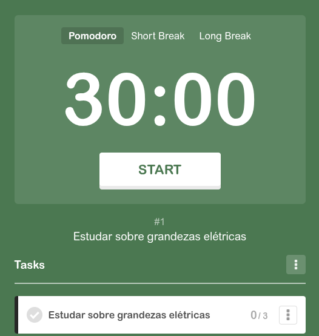
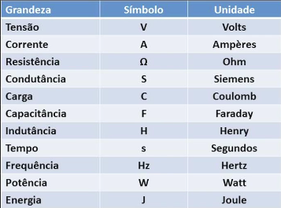

# 30-10-2026 · Aprendendo/Revisando grandezas elétricas

**Resumo:** Primeiro aprendizado, grandezas elétricas, estudando sobre tensão, corrente, resistência
**Tempo dedicado:** Cerca de 1h30, 3 pomodoros de 30x15x20
**Etapa do cronograma:** Semana 01 - Eletrônica básica: tensão, corrente, resistor, capacitor, uso do multímetro

---
## O que estudei
**Tema:** Grandezas elétricas | Corrente, resistor, capacitor...
**Fontes:**
- [Aula 1 do curso de circuitos elétricos da UNIVESP](https://www.youtube.com/watch?v=9T11Fph2pB8&list=PLxI8Can9yAHd1UnLqOLBQv7KbDq4Zsbax)
- BRAGA, Newton C. **Curso de eletrônica**: eletrônica básica. São Paulo: Instituto Newton C. Braga, 2012. v. 1.

## Pensamentos e notas
- Aproximações consideradas
     - Resposta instantânea, pequenos circuitos
     - Carga total em cada componente é nula
     - Elementos lineares fixos
     - Conservação da energia → Leis de Kirchoff
- Tensão é medida em Volts (V)
- Corrente é medida por Ampères (A)
- Resistência é medida em Ohm (Ω)

## Dúvidas
<!-- Para o professor ou para levar à orientação.
     Marque [x] quando resolver e anote a resposta. -->
- [ ]

## Fotos
<!-- 
     Uma legenda dizendo o que a foto mostra ajuda muito. -->

---

## Próximo passo
<!-- A primeira coisa a fazer na próxima sessão.
     Concreto o bastante para começar sem precisar pensar. -->
-